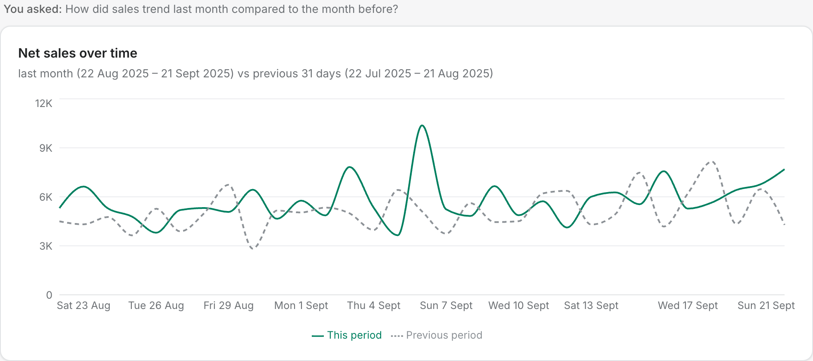
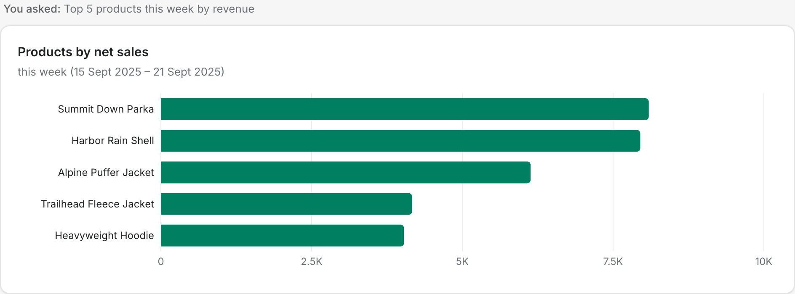
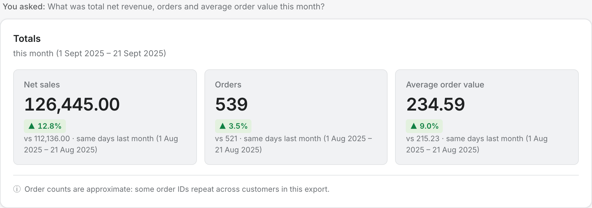
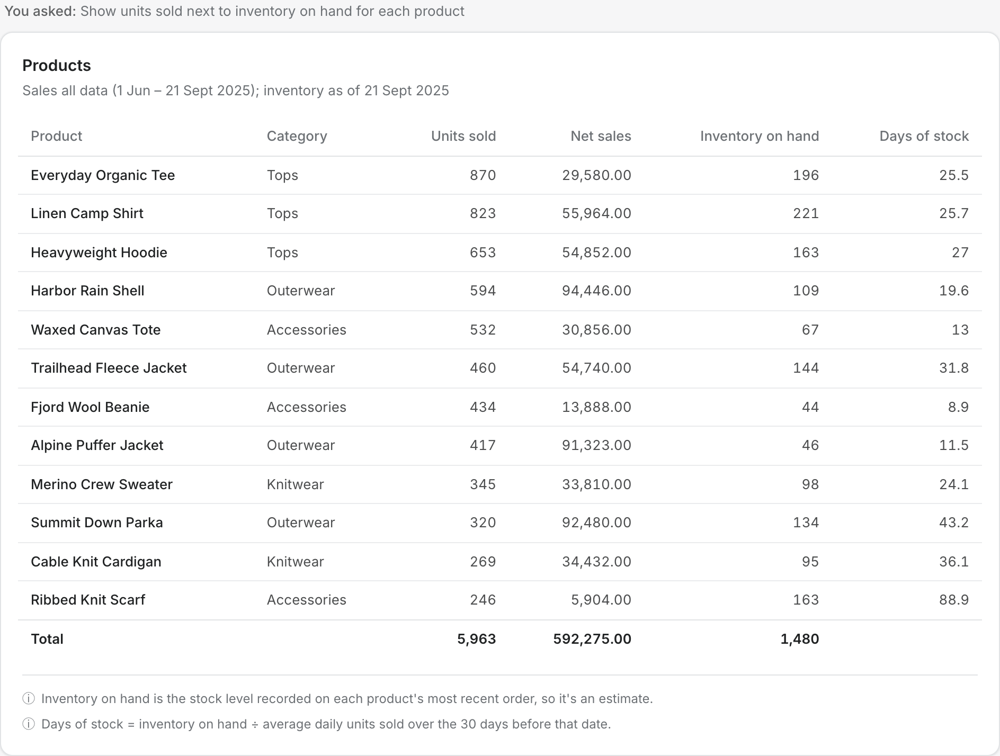

# Merchant Analytics

**Live dashboard: [shopifyswe-erik.vercel.app](https://shopifyswe-erik.vercel.app)**

Merchant Analytics lets a store owner ask questions about their sales in plain English and get charts back, without building reports or knowing where the numbers live. Type "how did sales trend last month compared to the month before?" or "show units sold next to inventory on hand", and the answer comes back as a line chart, bar chart, table or metric cards, built from the store's order data.

## What it's for

Merchants make day-to-day decisions from a handful of recurring questions, and answering them usually means exporting data and building a spreadsheet. The dashboard answers them directly:

- **Is the business growing?** Sales trends by day, week or month, and any period against the one before.
- **What's selling, and what's slowing down?** Products and SKUs ranked by revenue or units, and which ones are speeding up, slowing down or have stopped selling.
- **Where do sales come from?** Revenue split by sales channel (Online Store, Shop, Point of Sale, Instagram) and by shipping country.
- **What's being returned?** Refund totals, refund rates and the products driving them.
- **What needs reordering?** Units sold next to inventory on hand, with roughly how many days of stock are left.
- **Headline numbers:** total net revenue, units, orders or average order value for any period.

Questions can build on each other: each new one adds a chart to the current dashboard, so a merchant can put together a view of their week and come back to it from the history sidebar. When a question is too vague to chart, such as "what's slowing down since summer?" or a product that isn't in the store, the dashboard asks a clarifying question with options instead of guessing. Small typos like "jakets" are corrected automatically.

The data is the merchant order history in [`data/`](data/): 3,000 order line items from 1 June to 21 September 2025.

## What the answers look like

Every answer is one of four visuals, chosen by the kind of question.

**Line chart**: anything over time. Comparing with an earlier period adds it as a dashed line.



**Bar chart**: comparing products or SKUs side by side in one period.



**Metric cards**: single totals, each with its change from the previous period.



**Table**: several numbers for each item in a category.



To refresh these after UI changes, run `npm run dev`, then `npm run screenshots` in a second terminal.

## Limits of this prototype

- **Fixed data set.** Every answer comes from one CSV export of orders from 1 June to 21 September 2025. It isn't connected to a live store, so new orders don't appear.
- **Time is locked at 21 September 2025.** "Today", "last week" and "this month" all count back from that date, the last day in the data. The Update button and the `ANALYTICS_TODAY` setting are ready for live dates, but with this data later dates would show empty charts.
- **Static search.** The search box answers a fixed set of question types, each with a predefined chart: the ones listed under [What it can answer](#what-it-can-answer). It can't run open-ended analysis, explain *why* something happened, or answer questions outside those types.
- **No ad spend.** There's no marketing, traffic, cost or profit data, so questions about ad spend, ROAS, conversion rate, margins or website visits get "Sorry, I can't answer that because I don't have the data." The same goes for product details the export doesn't include, like colours and sizes.

## How it works

1. The merchant types a question on the home page. Small typos in product, category, channel and country names are corrected first ("jakets" → "jackets"), and the dashboard notes the correction.
2. Questions about data the store doesn't have (ad spend, traffic, costs, profit, reviews) get a fixed reply straight away, without calling the model: *"Sorry, I can't answer that because I don't have the data."*, plus two questions it can answer.
3. Questions too vague to chart get a clarifying question with options: seasons instead of dates ("since summer", "this season"), a comparison with only one side ("slowed down compared to July"), or a product that isn't in the store ("the Big Cozy"). Picking an option, or exact dates, re-asks the question with the answer filled in.
4. Common question shapes ("top 5 products this week", "sales by channel last month", "total revenue last week", "which products are running low on stock") are matched by rules in [`src/lib/router.ts`](src/lib/router.ts), which pick the tool directly. No model call, so these are instant and don't use the free model's daily allowance.
5. Anything the rules can't read confidently, and follow-ups like "now show it by channel", go to a language model ([`google/gemma-4-26b-a4b-it:free`](https://openrouter.ai/google/gemma-4-26b-a4b-it:free) on OpenRouter). Its only job is to pick a tool and pass the user's own words for the time period, such as "last week". It never writes the answer itself, so it can't make up numbers.
6. The tool computes the numbers from the CSV and returns a description of the visual. The dashboard draws it.

Each new question adds to the current dashboard. **New search** starts a fresh one, and past dashboards are listed in the history sidebar. History is saved in the browser.

## What it can answer

The question types, with real example questions and the tool call each should make, are in [`src/lib/question-guide.ts`](src/lib/question-guide.ts). The model reads this guide as worked examples.

| Question type | Visual | Example |
|---|---|---|
| Sales over time | Line | "trend of weekly sales since june, are we actually growing" |
| Sales by country over time | Line | "compare sales in canada vs the US last month" |
| Sales by channel over time | Line | "how much of my revenue came from online store vs pos last month" |
| Products by revenue | Bar | "top 5 products this week by revenue" |
| Product returns over time | Line | "refund total for Q3 so far and which items drove it" |
| Products over time | Line or bar | "which outerwear has been slowing down recently" |
| Totals | Metric cards | "what was total net revenue last week" |
| Product tables | Table | "show units sold next to inventory on hand for each product" |
| Comparing products | Line, one per product | "compare the parka and the hoodie over the past few weeks" |

Which visual to use is decided in code, not by the model: anything over time is a line chart, side-by-side comparisons are bar charts, several numbers per item are tables, and single totals are metric cards.

## Definitions

These live in [`src/lib/metrics.ts`](src/lib/metrics.ts) and every number goes through them.

- **Net sales** (what "sales" and "revenue" mean by default) = `line_total`. Unit price and line total are already after discount; some discounts are larger than the line total, which couldn't happen otherwise.
- **Gross sales** = `line_total + discount_amount`. Used only when someone asks for gross or "before discount".
- **Refunds / returns** = the `line_total` of fully refunded lines. Partially refunded lines are counted, but the export doesn't say how much was refunded, so they aren't given an amount.
- **Inventory on hand** = the stock level recorded on each product's most recent order, so it's an estimate.
- **Order counts** are approximate: the same `order_id` sometimes appears with different customers or dates in this export.
- Amounts have no currency symbol, because the export doesn't say which currency it uses.

## Dates

"Today" is fixed at **21 September 2025**, the last day in the data, so "last week" means 15–21 September. Ranges include both their first and last day.

The dashboard understands rolling periods ("past 7 days", "last month", "recently", "past few weeks"), calendar periods ("this month", "Q3 so far", "in August"), weekends and comparisons ("vs the month before"). Every period has a natural previous period to compare against. Seasons ("since summer", "this season") depend on hemisphere and definition, so the dashboard asks for exact dates instead.

The **Update** button re-runs every chart on the dashboard for the current "today", without calling the model. To make dates follow the real calendar, set `ANALYTICS_TODAY=today`. Until the data runs up to the present day, that will give empty charts.

## Setup

Requires Node.js 20.9 or later.

```bash
npm install
cp .env.example .env.local
```

Then add your OpenRouter key to `.env.local`:

| Variable | Required | What it does |
|---|---|---|
| `OPENROUTER_API_KEY` | Yes | Key from [openrouter.ai/keys](https://openrouter.ai/keys). Server-side only; never sent to the browser. |
| `OPENROUTER_MODEL` | No | Use a different OpenRouter model. Defaults to `google/gemma-4-26b-a4b-it:free`. The same key works for every model. |
| `ANALYTICS_TODAY` | No | The date that "today" and "last week" count from. Defaults to `2025-09-21`. Use `today` for the real date, or any `YYYY-MM-DD`. |

`.env.local` is git-ignored, so the key never gets committed.

## Scripts

| Command | What it does |
|---|---|
| `npm run dev` | Start the app for development. |
| `npm run build` | Production build. |
| `npm run lint` | Lint the code. |
| `npm run check:guide` | Check every example in the question guide: its inputs are valid, its tool runs on the data, it returns the right kind of visual, and the rules pick the same tool (or leave it to the model). Vague examples must ask the expected clarifying question and, once answered, reach the expected chart. Also checks every question the dashboard suggests is answered by the rules. No model calls. |
| `npm run check:guide -- --live` | Also ask the model, through the running app, about the examples the rules leave to it. |
| `npm run screenshots` | Capture the README screenshots from the running app into `docs/screenshots/`, using your installed Google Chrome. No model calls. |
| `npm run check:guide -- --live-all` | Ask the model about every example, skipping the rules. Uses about 23 of the 50 free daily requests. |

## Deploying

The app is set up for Vercel. Add `OPENROUTER_API_KEY` (and optionally `ANALYTICS_TODAY`) in the project's environment variables. The CSV is bundled with the API routes through `outputFileTracingIncludes` in [`next.config.ts`](next.config.ts).

The free model has a shared rate limit and a daily cap of 50 requests per OpenRouter account, across every free model. Questions answered by the rules don't count towards it. When a limit is hit, the dashboard says which one and when it resets, and offers a retry. A one-time purchase of 10 OpenRouter credits raises the daily cap to 1,000.

## Project structure

```
data/                        Merchant order history CSV
src/app/page.tsx             Home page: the dashboard
src/app/api/chat/            Streams tool results for a question
src/app/api/refresh/         Re-runs saved charts for the Update button
src/components/dashboard/    Dashboard, question cards, loader, visuals
src/lib/metrics.ts           Data loading, definitions, date rules
src/lib/plan.ts              The order a question goes through: typos, no-data, clarify, rules, model
src/lib/fuzzy.ts             Typo correction and name similarity
src/lib/clarify.ts           Clarifying questions for vague dates and unknown products
src/lib/router.ts            Rules that answer common questions without the model
src/lib/chat-tools.ts        The tools that compute each visual
src/lib/question-guide.ts    Question types and examples the model learns from
src/lib/charts.ts            The visual format tools return
src/lib/dashboard-client.ts  Browser-side state, history and streaming
scripts/                     The question guide check
```
